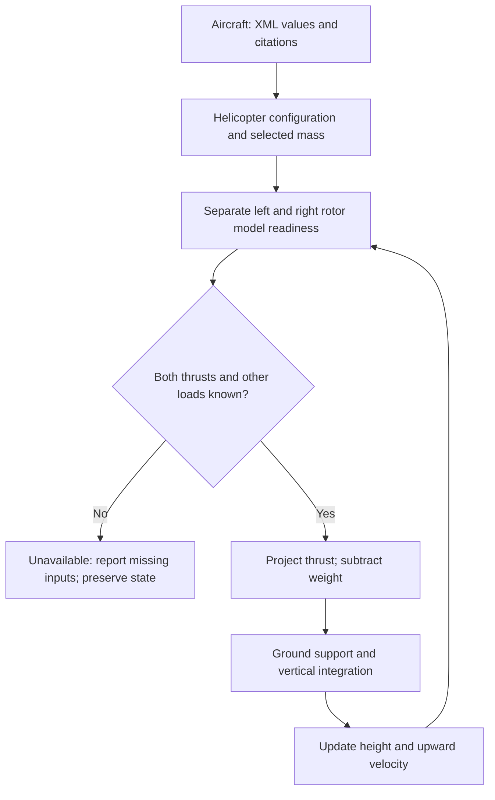

# TMPE — XV-15 helicopter-mode vertical takeoff

- Educational prototype focused on the two proprotors lifting the aircraft vertically from the runway.
- Starts stationary, level and on the ground, with nacelles at 90°. No runway acceleration or airplane takeoff model.
- Loads mass, rotor geometry/RPM, engine ratings, aircraft configuration and citation records from XML.
- Computes weight for the selected XML design-gross loading: 13,000 lb → 5,896.70 kg → 57,826.88 N at standard gravity.
- Supports vertical force balance, ground support and time integration when explicit forces are supplied.
- **Current aircraft run: UNAVAILABLE.** Rotor mast power, commanded collective and supported rotor thrust/torque maps are missing. No XV-15 takeoff trajectory is claimed.

## Usage

```bash
python3 'MY_physics_engine/tiltrotor_modeling_physics_engine(TMPE).py'
python3 'MY_physics_engine/tiltrotor_modeling_physics_engine(TMPE).py' --diagnostics
python3 'MY_physics_engine/tiltrotor_modeling_physics_engine(TMPE).py' --verbose
python3 'MY_physics_engine/tiltrotor_modeling_physics_engine(TMPE).py' --duration 5 --dt 0.1
python3 -m unittest discover -s tests -v
```

- Python 3 standard library only; no dependencies to install.
- Five environmental prompts remain: density, horizontal wind speed/direction, temperature and MSL ground elevation. Press Enter for defaults.
- Normal output prioritizes rotor thrust, weight, net force and vertical state.
- Diagnostics shows XML loading records and force-model blockers. Verbose adds equations and the secondary freestream AoA trace. Flags can be combined.
- Duration and timestep are requested settings; missing forces stop the run without advancing time. Initial zero height/velocity are identified as initial conditions.

## Architecture



- `calculate_proprotor()` evaluates each rotor's input readiness; no supported actual rotor law exists yet.
- `rotor_force_body_n()` projects axis thrust: `(T cos(beta), 0, -T sin(beta))`; body axes are forward/right/down.
- `vertical_force_balance()` uses upward-positive forces: `F = TL sin(betaL) + TR sin(betaR) + Fother - mg`.
- `integrate_vertical()` holds force constant over each step: `h += v*dt + 0.5*a*dt²`, `v += a*dt`. Ground support prevents downward acceleration at rest on the runway; ground crossings stop at zero height.
- `simulate_takeoff()` reevaluates forces each step. Its optional Python `force_provider(time, height, upward_velocity)` supplies left/right thrust and other upward force in SI. This extension supports mechanics tests and future source-backed models; test forces are not XV-15 performance data.
- Wing AoA helpers and word banks remain available. Wing freestream lift does not determine takeoff.

## Data and model limits

- `mass.xml`: selected design gross weight, interpreted as aviation gross weight in lb; standard-gravity conversion to mass and weight is explicit.
- `rotor.xml`: diameter, per-rotor disk area and design hover RPM. Design RPM is not a commanded rotor setting.
- `engine.xml`: per-engine takeoff rating, tied to its stated standard-day condition and duration; not actual mast power.
- `aircraft.xml`: engine count and cited helicopter nacelle orientation.
- `geometry.xml`: existing geometry and NotebookLM recovery with per-item citations, units and verification flags.
- `relationships.xml`: reported 93% transmission relationship retained for inspection; no unverified operating power or equal power split is inferred.
- The reported 7% OGE hover download is not applied to ground liftoff. Ground effect, wake download and climb/drag loads need applicable models.
- Ideal hover momentum theory alone cannot establish actual mast power, losses, collective or a thrust law valid through ground liftoff and climb. No ideal estimate is substituted for actual thrust.
- `LOADED` means parsing succeeded; it does not certify aircraft data. Unknown values remain `None`.
- Vertical translation only; no attitude dynamics, transition, flight-by-wire or landing-response model.
- Tests verify equations and software behavior, not agreement with XV-15 flight-test thrust or trajectories.

## References and maintenance

- [Source registry](MY_physics_engine/data(v.2)/sources.xml) preserves original citations.
- [NASA TM-81244](https://ntrs.nasa.gov/api/citations/19810001546/downloads/19810001546.pdf), printed p. 4 / PDF p. 6: checked 0° airplane / 90° helicopter nacelle convention; printed p. 2 / PDF p. 4: 13,000 lb design gross weight. Registered as S14.
- [NotebookLM geometry response](MY_physics_engine/data(v.2)/notebooklm_geometry_recovery_2026-11-10.md): supplied claims remain separately flagged.
- [Debugging guide](docs/TMPE_DEBUGGING.md) and [physics/variable reference](docs/TMPE_REFERENCE.md).
- The quick and detailed word banks remain in the Python script.
